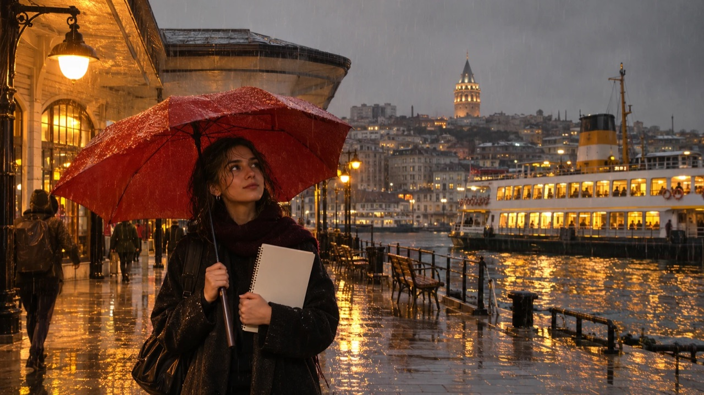
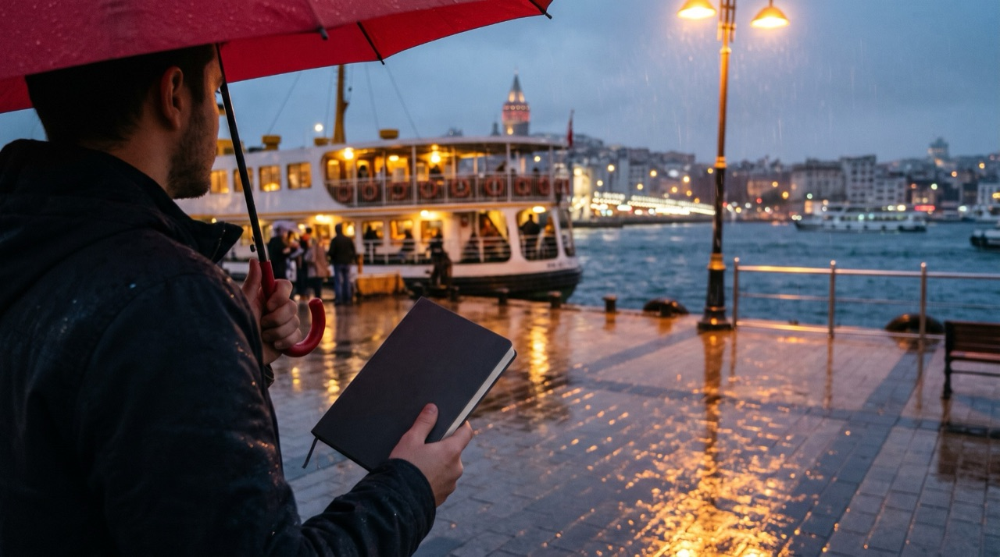
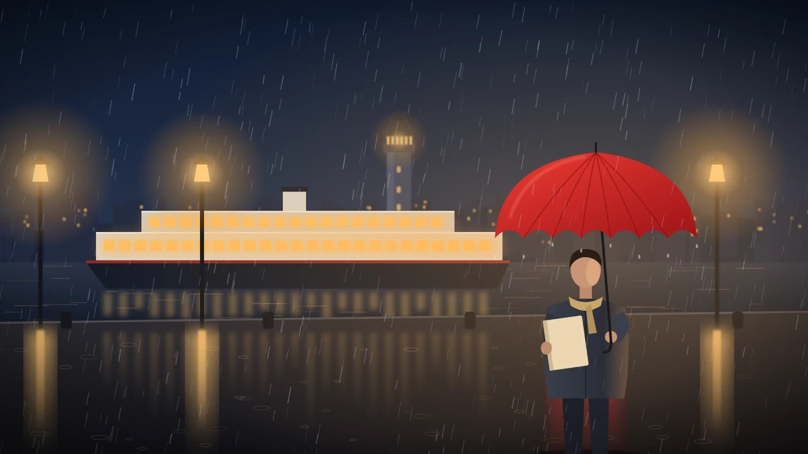

# Task 3: Görsel Prompt Benchmark

Bu hafta sadece görsel kısmını yaptım (3 fotoğraf modeli). Metin modelleri ve video kısmını yapmadım.

## Prompt (3 modele de aynen verildi, yeni sohbet, ilk sonuç)

> A rainy evening at a ferry pier in Istanbul. In the foreground, a university student holds a red umbrella and a plain notebook with a blank cover, no text anywhere. Behind them, a ferry with warm lit windows and the Galata Tower on the skyline. Realistic photograph, warm street lamp light, wet reflections on the ground, 16:9.

## Puanlama ölçütü (önceden yazdım, her biri 1-5)

- **Sadakat:** kırmızı şemsiye, vapur, Galata Kulesi, yağmur, ıslak zemin yansıması ve yazısız defter var mı?
- **Yüz/detay:** yüz ve eller doğal mı, görüntü gerçekçi bir fotoğraf gibi mi?

## Sonuçlar

| Model | Sadakat | Yüz/detay | Toplam /10 |
|---|---|---|---|
| Gemini | 5 | 5 | **10** |
| ChatGPT | 4 | 4 | **8** |
| Claude | 2 | 2 | **4** |

**ChatGPT** 

**Gemini** 

**Claude** 

## Yorum

Üç modele de aynı prompt'u verdim. Bence en iyisi Gemini oldu, çünkü gerçekten çekilmiş bir fotoğraf gibiydi: yağmurdaki ışıklar, ıslak zemin ve kişinin duruşu daha doğaldı, prompt'taki "gerçekçi fotoğraf" isteğine en yakın olan oydu. Küçük eksikleri vardı, Galata Kulesi küçük kaldı ve şemsiye kadrajdan taştı. ChatGPT de çok iyiydi, kırmızı şemsiye, vapur, Galata Kulesi ve yağmur hepsi vardı, ama bana fazla parlak ve sinematik, yani biraz yapay göründü. Claude'un çıktısı en kötüsüydü, çünkü fotoğraf yerine düz bir çizim yaptı, kule Galata'ya değil de fenere benziyordu ve kişinin yüzü yoktu. Üçünde de defterin üstüne yazı koymadılar, bu kısmı hepsi doğru yaptı. Beni şaşırtan şey Claude'un bir görsel modeli olmaması, çizimi muhtemelen kodla yaptı. O yüzden fotoğraf testinde adil bir karşılaştırma olmadı.
